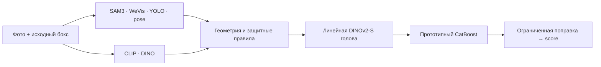

<div align="center">

# RASCAR · Prototype Baseline

### Поиск ошибок детектора по изображению и геометрии бокса

**Public AP 0.96300** &nbsp; · &nbsp; **OOF AP 0.988579935** &nbsp; · &nbsp; Python 3.11

[Решение 0.97564](https://github.com/magaoutside/johny-makbobins-family/tree/spatial-ensemble) · [Решение 0.96300](https://github.com/magaoutside/johny-makbobins-family/tree/prototype-baseline)

</div>

На входе — фотография и предложенный детектором бокс. На выходе — **вероятность ошибки бокса**: неправильный класс, положение, размер или лишний дубль. Чем выше `score`, тем подозрительнее бокс. Исходные координаты не меняются.

Классы: `person`, `nude_hands`, `cup`, `tray`. **198** размеченных запросов в train, **362** запроса в test. Метрика — Average Precision.

## Начать здесь

| Нужно | Команда после установки | Результат |
|---|---|---|
| Получить исходный сабмит на CPU | `python predict.py` | `outputs/submission.csv` |
| Проверить каждое предсказание и AP | `python verify.py` | `outputs/verification.json` |
| Переобучить 6 прототипных моделей | `python train.py` | `outputs/trained_models/` |
| Пересчитать раннюю цепочку на сохранённых признаках | `python rebuild_upstream.py` | `outputs/rebuilt_features/guarded_scores.csv` |
| Пересчитать всё из фотографий на GPU | `python from_images.py` | `outputs/from_images/predictions/submission.csv` |
| Переобучить всю цепочку на GPU | `python from_images.py --retrain --out outputs/full_training` | новые веса, признаки и сабмит в `outputs/full_training/` |

> **Что проверено.** CPU-сабмит, переобучение прототипных CatBoost и ранняя цепочка воспроизводятся численно. Для полного пути от фотографий приложены генераторы всех признаков, обученные веса и обучение. Этот объединённый GPU-путь после переноса **ещё не прошёл сквозной прогон в чистом окружении**; его нельзя считать проверенным на побитовое совпадение. Подробности — [проверки и происхождение данных](REPRODUCIBILITY.md).

## 1. Получить сабмит — пять шагов

Нужны Git и **Python 3.11**. GPU и доступ к Kaggle для этого маршрута не нужны: компактные признаки и собственные обученные модели уже в ветке.

```bash
git clone --branch prototype-baseline --single-branch https://github.com/magaoutside/johny-makbobins-family.git
cd johny-makbobins-family
python3.11 setup_env.py
source .venv/bin/activate
python predict.py
python verify.py
```

**Готовый файл для отправки — `outputs/submission.csv`: 362 строки, столбцы `id,score`.**

Windows: активация окружения — `.venv\Scripts\activate`. `reference/submission.csv` — исходный отправленный файл; `predict.py` его не читает. `verify.py` сравнивает каждый скор, ID, порядок строк, допустимый диапазон и OOF AP. Допуск совпадения — `1e-10`.

## 2. Что находится в репозитории

| Файл / папка | Назначение |
|---|---|
| [predict.py](predict.py) | Единственная точка входа для финальных предсказаний. |
| [train.py](train.py) | Обучение выбранных финальных моделей. |
| [from_images.py](from_images.py) | Полная последовательность: фотографии → признаки → модели → сабмит. Флаг `--retrain` включает переобучение. |
| [prepare.py](prepare.py) | Отдельные этапы извлечения признаков. Список: `python prepare.py --help`. |
| [rebuild_upstream.py](rebuild_upstream.py) | Пересчёт раннего ансамбля из детекций и эмбеддингов; без GPU. |
| [rebuild_baseline.py](rebuild_baseline.py) | Инференс / обучение линейной DINOv2-S головы перед прототипной моделью. |
| [download_weights.py](download_weights.py) | Скачать foundation-веса по закреплённым ревизиям и проверить их целостность. |
| [download_data.py](download_data.py) | Скачать данные соревнования или распаковать существующий ZIP. |
| [models/](models/) | Веса финальных моделей этой ветки и линейной пространственной базы. |
| [data/](data/) | Запросы, train-метки, геометрия, эмбеддинги и сохранённые предсказания экспертов. |
| [rascar/](rascar/) | Реализация признаков, обучения, инференса и смешивания. |
| [upstream/](upstream/) | Только используемая ранняя цепочка: код, дообученные веса, кэши и дополнительные train-аннотации. |
| [reference/](reference/) | Эталон для проверки результата. Не вход модели. |
| [config.json](config.json) | Выбранные признаки, seeds и коэффициенты. |
| [checksums.json](checksums.json) | SHA256 каждого поставляемого артефакта. |
| `outputs/`, `cache/` | Новые результаты и большие скачанные файлы. Исключены из Git. |

## 3. Суть решения



Независимые модели проверяют присутствие объекта и согласованность его границ. Специалисты по рукам работают на увеличенных кропах, с поворотами и обучением на полных аннотациях. Геометрические правила учитывают головы, суставы, части тела вне бокса и дубли. Линейная голова DINOv2-S уточняет заполненность бокса.

Прототипный этап использует **22 геометрических признака + 27 сходств с GT-прототипами CLIP/DINOv2 + категорию класса**. Прототипы берутся только из дня обучения; совпадающий кадр исключается. Шесть CatBoost — два направления по дням × три seed — консервативно корректируют скоры людей.

## 4. Повторить обучение на сохранённых признаках

```bash
python train.py
python predict.py --models outputs/trained_models --out outputs/retrained
python verify.py --out outputs/retrained
```

Обучение использует `data/train_labels.csv`, а новые веса сохраняет отдельно. Состав фолдов и признаки записываются в `outputs/trained_models/training.json`. Этот CPU-маршрут проверен на численное совпадение с исходным запуском.

Пересчёт ранних моделей и правил:

```bash
python rebuild_upstream.py
```

Кэш содержит детекции / эмбеддинги, а не готовые результаты всех промежуточных моделей. Скрипт заново обучает выбранные ранние CPU-модели и последовательно передаёт их выход следующему этапу. Для применения пересчитанного скора используйте полный маршрут ниже: он передаёт новую папку данных всем последующим командам.

## 5. Полный путь от фотографий — GPU

Запускайте на Linux с NVIDIA GPU, например в Kaggle Notebook. WeVis — самый тяжёлый этап; для него практичнее GPU с 24 GB памяти или больше. Точное время и пиковая память объединённого запуска не измерены. Подготовьте место под foundation-модели, исходные фотографии и несколько отдельных окружений.

### Установить окружения и получить входные данные

```bash
python3.11 setup_env.py --gpu
source .venv/bin/activate
python -m pip install -r requirements-download.txt
python download_data.py
python download_weights.py
```

Доступ к соревнованию и gated-моделям SAM3.1 / DINOv3 оформляется у владельцев источников. Для Hugging Face используйте переменную `HF_TOKEN` или штатный login; токен не записывается в код. Скрипт не принимает условия доступа за вас.

Если архив уже есть: `python download_data.py --archive /path/to/competition.zip`.
Если данные подключены в Kaggle: передайте их каталог в `--raw`, скачивать повторно не требуется.

### Пересчитать с исходными обученными весами

```bash
python from_images.py --raw cache/competition --device cuda:0
python verify.py --out outputs/from_images/predictions --allow-drift
```

Все промежуточные данные появляются в `outputs/from_images/`. Этот маршрут **не копирует кэш признаков из `data/` или `upstream/data/`**. Он получает метаданные из исходных CSV, извлекает признаки из JPG, использует приложенные дополнительные train-аннотации и обученные веса. Сохранённые данные ветки используются для сравнения результата.

`--allow-drift` выводит расхождение и AP; он не скрывает ошибку. Разные GPU и версии библиотек могут менять численные значения. Точный исходный сабмит получают маршрутом из раздела 1.

### Обучить всю выбранную цепочку заново

```bash
python from_images.py --raw cache/competition --retrain --out outputs/full_training --device cuda:0
python verify.py --out outputs/full_training/predictions --allow-drift
```

Этот запуск обучает детекторы, ранние классификаторы, линейную DINO-голову и финальные модели. Foundation-backbones остаются замороженными. Новые checkpoint-файлы сохраняются внутри `outputs/full_training/`; исходные веса не перезаписываются.

Можно продолжить с этапа: `--start foundation|local|guards|tta|body|sahi|kernel|boundary|final`. При продолжении укажите тот же `--out`; предыдущие этапы должны быть завершены. Для переобучения сохраните флаг `--retrain`.

Полная карта генераторов, окружений, аннотаций и весов: [REPRODUCIBILITY.md](REPRODUCIBILITY.md).

## 6. Качество и ограничения оценки

| Оценка | AP |
|---|---:|
| Kaggle Public | **0.96300** |
| Объединённый opposite-day OOF | **0.988579935** |
| Проверка на 25 октября, обучение на 26 октября | 0.976779053 |
| Проверка на 26 октября, обучение на 25 октября | 0.993283764 |

Public AP — результат отправленного CSV, сообщённый участником команды. OOF — обучение на одном дне и проверка на другом; тест — ансамбль двух направлений. OOF многократно использовался при выборе моделей и коэффициентов, поэтому это development-оценка, а не независимый финальный holdout. Визуальный просмотр теста повлиял на общие эвристики; визуальные предположения не считаются истинной тестовой разметкой.

## 7. Если что-то не запускается

| Проблема | Решение |
|---|---|
| Нужен только CSV, нет GPU | Раздел 1. |
| `Missing or changed release artifact` | Восстановить файл этой ветки; не смешивать артефакты двух решений. |
| Не найден checkpoint | `python download_weights.py`; собственные дообученные веса уже в Git. |
| 401 / 403 от Kaggle или Hugging Face | Проверить авторизацию и доступ к конкретному источнику. |
| Нет `Sam2Model` / несовместимые Transformers | Установить окружения через `setup_env.py --gpu`; `from_images.py` выбирает нужный Python. |
| Не хватает GPU-памяти | Использовать GPU с большей памятью; CPU-сабмит остаётся доступен без пересчёта foundation-моделей. |
| Прерывание GPU-этапа | Посмотреть последний лог в `outputs/from_images/upstream/logs/`, исправить причину и продолжить через `--start`. |

Источники pretrained-весов закреплены в [weights.json](weights.json). Происхождение собственных checkpoint-файлов и их SHA256 — [upstream/weights/manifest.json](upstream/weights/manifest.json).
