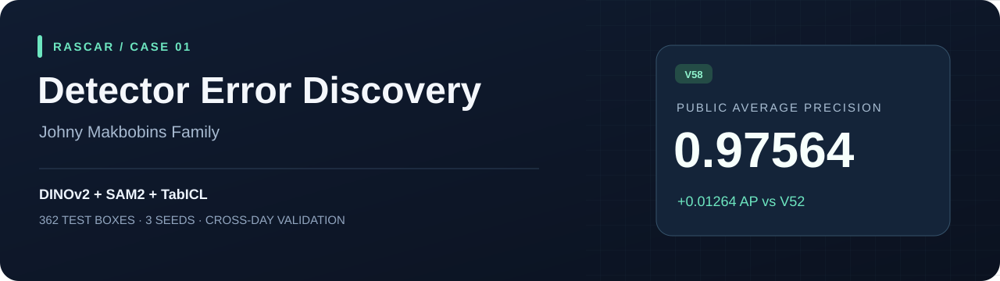
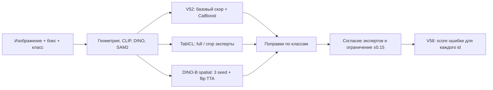

<p align="center">
  
</p>

<p align="center">
  <a href="#быстрый-запуск">Запуск</a> ·
  <a href="docs/METHOD.md">Метод</a> ·
  <a href="docs/EXPERIMENTS.md">Эксперименты</a> ·
  <a href="docs/REPRODUCIBILITY.md">Воспроизведение</a> ·
  <a href="research/README.md">Полный код</a>
</p>

# Семья Джони Макбобинса

Решение команды для **RASCAR — Case 1: Detector Error Discovery**. Для каждого готового bounding box мы оцениваем, насколько вероятна ошибка детектора: неверный класс, пропущенная часть объекта, лишняя область или отсутствие объекта. Чем выше `score`, тем выше бокс в очереди на проверку.

Финальная версия **V58 получила Public AP 0.97564**, улучшив V52 на **0.01264 AP**. В репозитории — обе версии, обученные компактные модели, входы для воспроизведения, валидация и полная доступная история исходников.

## Результаты

| Версия | Public AP | Development OOF AP | Роль |
|:--|--:|--:|:--|
| **V58** | **0.97564** | **0.992917** | Финальное решение |
| V57 | — | 0.992147 | Промежуточная коррекция скоров |
| V56 A40 | 0.96285 | — | Проверенный на Kaggle кандидат |
| V52 | 0.96300 | 0.988580 | Предыдущий лучший сабмит |

Public V58 сообщён участником после отправки. Private AP и итоговое место здесь не заявлены. OOF — разделение по дням на **198 боксах / 35 кадрах**, многократно использованное для выбора моделей; его нельзя считать независимой оценкой после подбора. [Метрики и ограничения →](docs/VALIDATION.md)

## Идея решения

Мы сравниваем бокс с независимыми визуальными свидетельствами и аккуратно корректируем уже сильный базовый скор.



- **V52:** геометрические признаки и сходство с прототипами → шесть CatBoost-моделей; поправка для `person`.
- **V57:** SAM2/TabICL-эксперты по контексту и кропу; ограниченные поправки для `person`/`cup`, адаптация распределения для `nude_hands`.
- **V58:** пространственная DINOv2-B голова для `cup`, три seed и реальный RGB flip TTA. Поправка применяется при согласии экспертов; `tray` получает общий сдвиг в logit-пространстве. Итог ограничен отклонением **±0.15 от V52**.

[Формулы, архитектура и обучение →](docs/METHOD.md)

## Быстрый запуск

**Python 3.11, CPU.** Для воспроизведения сохранённых сабмитов GPU и доступ к Kaggle не нужны.

```bash
git clone https://github.com/magaoutside/johny-makbobins-family.git
cd johny-makbobins-family
python3.11 -m venv .venv
source .venv/bin/activate
python -m pip install -r requirements.txt
python scripts/reproduce.py --version all
```

Результаты появятся в `outputs/`:

```text
outputs/
├── v52/test_a20.csv              # Инференс сохранённых CatBoost
├── v58/submission.csv            # Финальная сборка V58
└── verification.json            # Проверки формата, id и совпадения скоров
```

**Граница воспроизводимости:** V52 запускает модели по сохранённым признакам; V58 собирает итог по сохранённым прогнозам экспертов. Это проверенный replay конкретных 362 test-боксов. Полное обучение и извлечение признаков из RGB описаны [отдельно](docs/REPRODUCIBILITY.md#обучение-и-rgb-инференс).

Только одна версия:

```bash
python scripts/reproduce.py --version v58
python scripts/reproduce.py --version v52
```

## Навигация по репозиторию

| Путь | Содержимое |
|:--|:--|
| [`solutions/v58/`](solutions/v58/) | Читаемая финальная формула, replay-входы, выбранные DINO-головы и модели-предшественники |
| [`solutions/v52/`](solutions/v52/) | Шесть CatBoost, признаки, прототипы и автономный replay |
| [`submissions/`](submissions/) | Оригинальные CSV V52 и V58 |
| [`research/rascar_v58/`](research/rascar_v58/) | Все скрипты новых GPU-экспериментов, TTA, отбора и аудита |
| [`research/rascar_v52/`](research/rascar_v52/) | Подготовка признаков, обучение, аугментации и сравнения V52 |
| [`research/`](research/) | 600 файлов исходников, включая предыдущие версии и общие зависимости |
| [`reports/`](reports/) | OOF, метрики по дням, seed, стресс-проверки и разбор ошибок |
| [`docs/`](docs/) | Метод, данные, эксперименты и инструкции |

Исторические скрипты сохранены для исследования: у них остаются исходные пути и зависимости от промежуточных файлов. Поддерживаемая точка входа для готовых сабмитов — `scripts/reproduce.py`.

## Что изменилось в ошибках

На исходных 49 проблемных обучающих боксах V58 улучшил ранжирование **36**, полностью устранил инверсии у **14**, ухудшил **8**, оставил **5** без изменений. Число ошибочно упорядоченных пар уменьшилось **153 → 91**: исправлено 80 старых, появилось 18 новых.

Визуальные замечания к тесту — гипотезы, а не скрытая разметка. Они использованы для отчёта после фиксации кандидата, а не как цели обучения или критерий его выбора. [Полный разбор →](docs/VALIDATION.md)

## Ссылки

- [Соревнование: RASCAR Case 1](https://www.kaggle.com/competitions/rascar-hack-case-1)
- [GPU notebook: V58 final verified, Version 2](https://www.kaggle.com/code/shapodev/rascar-v56-gpu-final-experiments) — доступ к приватному ноутбуку и Output зависит от разрешений Kaggle.
- [Карта артефактов и контрольные суммы](docs/ARTIFACTS.md)
- [Использованные модели и библиотеки](THIRD_PARTY.md)

Обучение новых нейросетевых экспертов выполнялось на **двух Tesla T4 в Kaggle**. Локально выполнялись сборка, аудит и расчёт метрик.
