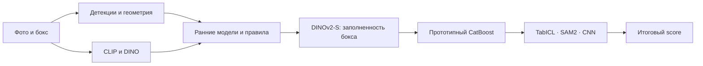

<div align="center">

# RASCAR · Spatial Ensemble

**Public AP 0.97564** · **OOF AP 0.992917428** · Python 3.11

[Spatial Ensemble · 0.97564](https://github.com/magaoutside/johny-makbobins-family/tree/spatial-ensemble) · [Prototype Baseline · 0.96300](https://github.com/magaoutside/johny-makbobins-family/tree/prototype-baseline)

</div>

На входе — фотография и бокс детектора. На выходе — `score` ошибки: чем он выше, тем вероятнее неправильный класс, границы или дубль. Координаты бокса не меняются.

Классы: `person`, `nude_hands`, `cup`, `tray`. **198** размеченных запросов, **362** тестовых. Метрика — Average Precision.

## Получить сабмит на CPU

Признаки и наши обученные модели уже в репозитории. Нужны Git и Python 3.11.

```bash
git clone --branch spatial-ensemble --single-branch https://github.com/magaoutside/johny-makbobins-family.git
cd johny-makbobins-family
python3.11 setup_env.py
source .venv/bin/activate
python predict.py
python verify.py
```

**Результат: `outputs/submission.csv` — 362 строки, столбцы `id,score`.** На Windows окружение активируется командой `.venv\Scripts\activate`.

## Как устроено решение



SAM3, WeVis, YOLO и pose проверяют присутствие объекта и согласованность границ. Специалисты по рукам используют увеличенные кропы, повороты и детекцию по тайлам. Ранние модели объединяют эти сигналы с геометрией.

Прототипный этап: **22 геометрических признака + 27 сходств CLIP/DINOv2 + класс**. Шесть CatBoost обучаются по двум дням с тремя seed; прототипы берутся из дня обучения, совпадающий кадр исключается.

Финальный ансамбль добавляет SAM2-признаки устойчивости границ, 18 контекстов TabICL и 6 пространственных CNN на DINOv2-B. Поправки ограничены по величине; формула — [rascar/blend.py](rascar/blend.py).

По умолчанию выходы TabICL/CNN читаются из сохранённых признаков. `predict.py --mode models` запускает эти эксперты заново; для него нужны плотные DINO-карты и скачанные foundation-веса.

## Пересчитать из фотографий на GPU

Linux, NVIDIA GPU, Python 3.11. Для Kaggle — [готовый ноутбук](notebooks/reproduce.ipynb). Для загрузки нужны доступ к соревнованию и `HF_TOKEN` с доступом к SAM3.1 и DINOv3.

```bash
python3.11 setup_env.py --gpu
source .venv/bin/activate
python -m pip install -r requirements-download.txt
python download_data.py
python download_weights.py
python from_images.py --raw cache/competition --device cuda:0
python verify.py --out outputs/from_images/predictions --allow-drift
```

Результат — `outputs/from_images/predictions/submission.csv`. Если данные уже скачаны, передайте их каталог через `--raw`; архив можно распаковать командой `python download_data.py --archive /path/to/competition.zip`.

### Машинный пул

Полный запуск включает `generate_pool.py`: исходные машинные боксы → YOLO и DINOv3 → отбор псевдоразметки → обучение специалистов. Визуальные решения по обучающему пулу хранятся отдельно от модельных оценок.

Отдельный запуск после установки GPU-окружений и загрузки данных/весов:

```bash
python generate_pool.py --raw cache/competition --out outputs/machine_pool --device cuda:0
```

Результаты: `approved_pseudo_boxes_2026-10-25.csv`, `approved_pseudo_boxes_2026-10-26.csv`, журнал оценок и `manifest.json` в указанной папке. Подробности — [REPRODUCIBILITY.md](REPRODUCIBILITY.md#машинный-пул).

## Обучить заново

Шесть прототипных CatBoost на сохранённых признаках:

```bash
python train.py
python predict.py --models outputs/trained_models --out outputs/retrained
```

Вся цепочка из фотографий, включая машинный пул:

```bash
python from_images.py --raw cache/competition --retrain --out outputs/full_training --device cuda:0
python verify.py --out outputs/full_training/predictions --allow-drift
```

Новые веса сохраняются в папке запуска. Для продолжения укажите тот же `--out`, прежний режим `--retrain` и этап `--start`, например `pool`, `sahi` или `final`.

## Что где лежит

| Файл / папка | Назначение |
|---|---|
| [predict.py](predict.py), [train.py](train.py), [verify.py](verify.py) | Предсказания, обучение финальных моделей, проверка результата. |
| [from_images.py](from_images.py), [prepare.py](prepare.py) | Полная цепочка и отдельные этапы извлечения признаков. |
| [generate_pool.py](generate_pool.py) | Модельный отбор машинного пула и обучение его семантических голов. |
| [rebuild_upstream.py](rebuild_upstream.py), [rebuild_baseline.py](rebuild_baseline.py) | Ранний CPU-ансамбль и линейная DINOv2-S модель. |
| [setup_env.py](setup_env.py), `requirements*.txt` | Окружения и зависимости. |
| [download_data.py](download_data.py), [download_weights.py](download_weights.py) | Загрузка исходных данных и foundation-весов. |
| [rascar/](rascar/), [upstream/code/](upstream/code/) | Реализация моделей, признаков и ранних этапов. |
| [models/](models/), [upstream/weights/](upstream/weights/) | Наши обученные модели. |
| [data/](data/), [upstream/data/](upstream/data/) | Сохранённые признаки для CPU-запуска. |
| [upstream/annotations/](upstream/annotations/) | Решения разметки обучающего пула и сохранённый результат отбора. |
| [config.json](config.json), [weights.json](weights.json), [checksums.json](checksums.json) | Настройки, источники foundation-весов и контрольные суммы. |
| [reference/](reference/) | Исходные предсказания для сравнения; не вход модели. |
| `outputs/`, `cache/` | Результаты запусков и загрузки; исключены из Git. |

Происхождение признаков и веса: [REPRODUCIBILITY.md](REPRODUCIBILITY.md). Измерения и условия оценки: [VALIDATION.md](VALIDATION.md).

## Метрики

| Оценка | AP |
|---|---:|
| Kaggle Public | **0.97564** |
| Opposite-day OOF | **0.992917428** |
| Проверка на 25 октября, обучение на 26 октября | 0.985281470 |
| Проверка на 26 октября, обучение на 25 октября | 0.995434438 |
